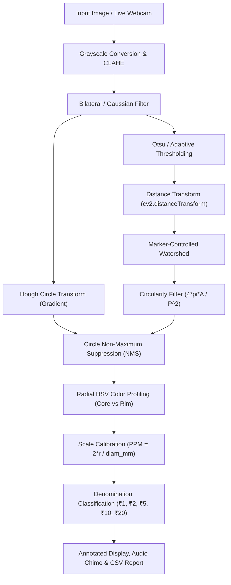

# Automated Coin Detection and Counting Using OpenCV 🪙

[](https://coin-detector-cv.onrender.com)
[](https://www.python.org/)
[](https://opencv.org/)
[](https://palletsprojects.com/p/flask/)
[](https://opensource.org/licenses/MIT)

> 🌐 **Live Web Application:** [**https://coin-detector-cv.onrender.com**](https://coin-detector-cv.onrender.com)  
> (Accessible directly from any smartphone, tablet, or PC with full live webcam support over HTTPS)

An end-to-end Computer Vision system that **detects, classifies, counts, and calculates the total monetary amount** of coins in real time using **OpenCV** and **Python**.

Designed specifically for **Indian Rupee (INR)** coins (**₹1, ₹2, ₹5, ₹10, ₹20**), this project features a modern **Web Application** (WebRTC live camera, photo upload, interactive tuning sliders, scale calibration), a **Desktop OpenCV GUI** with live trackbars, and an educational **6-Stage Computer Vision Pipeline Inspector** for academic presentations and viva examinations.

---

## 📸 Key Features

- **🔴 Real-World Wood Grain & Ambient Lighting Robustness:**
  - Standard Hough Transform often fails on textured backgrounds (desks, wood grain tables), producing dozens of false positive circles.
  - Our **Adaptive Illumination Normalization (Morphological Top-Hat / Black-Hat)** removes non-uniform lighting gradients and wood streaks before detection.
  - **Circumferential Edge Coherence Verification** ensures only closed circular physical boundaries are recognized, rejecting wood knots and background scratches.
- **🪙 Multi-Series Indian Rupee (INR) Support:**
  - Accurately classifies both the **2011/2019 "New ₹ Symbol" Series** (20mm ₹1, 23/25mm ₹2, 23mm ₹5, 27mm ₹10) and earlier circulating coins like the **2007 "Hastamudra / Thumbs-Up" Series** (25mm ₹1 with smooth field vs 25mm ₹2 with dense floral motifs).
- **🔴 Live Camera Detection:**
  - Browser WebRTC live camera stream (`navigator.mediaDevices.getUserMedia`) with multi-camera selector.
  - Native OpenCV backend MJPEG video stream (`/video_feed`).
- **💰 Total Monetary Value & Denomination Breakdown:**
  - Automatically calculates the sum in Indian Rupees (e.g. `Total: ₹17`).
  - Itemized count cards for **₹1, ₹2, ₹5, ₹10, and ₹20** coins.
  - Interactive table allowing users to click any coin's badge to toggle or adjust denomination.
- **🔬 Multi-Algorithm Detection Engine:**
  - **Hough Circle Transform (`cv2.HoughCircles`):** 2-1 gradient voting method for circular rims.
  - **Marker-Controlled Watershed Segmentation (`cv2.watershed`):** Euclidean distance transform separates touching and overlapping coins.
  - **Circularity Filtering:** $C = \frac{4\pi \cdot \text{Area}}{\text{Perimeter}^2} \ge 0.65$.
  - **Circle Non-Maximum Suppression (NMS):** Deduplicates concentric rings and false positive artifacts.
- **🎨 Multimodal Denomination Reasoning:**
  - Combines physical diameter ratios (calibrated in mm) with **radial HSV color-space analysis**:
    - **₹10 / ₹20:** Bimetallic outer golden ring ($S > 75$) + inner silver core ($S < 50$).
    - **₹5:** Nickel-Brass golden signature ($10 \le H \le 42$, $S \ge 40$).
    - **₹1 & ₹2:** Ferritic stainless steel silver signature ($S < 35$), separated by physical diameter (20 mm vs 25 mm).
- **🎛️ Interactive Calibration & Parameter Tuning:**
  - Live sliders for Hough accumulator sensitivity (`param2`), Min/Max radius, Canny thresholds, and Blur.
  - **Click-to-Calibrate:** Click directly on any coin on screen to set it as the reference coin (e.g. ₹10 = 27mm).
- **🎓 6-Stage Educational CV Pipeline Inspector:**
  - Side-by-side visualization of:
    1. Original Capture
    2. Grayscale & CLAHE (Contrast-Limited Adaptive Histogram Equalization)
    3. Bilateral & Gaussian Noise Filtering
    4. Canny Edge Detection
    5. Euclidean Distance Transform & Watershed Segmentation
    6. Final Annotated Detections & Classification
- **📊 Export & Audio Feedback:**
  - Synthesized Web Audio API coin chime on detection.
  - Download annotated image, download 6-stage montage, export CSV report, and print summary report.

---

## 📐 Indian Rupee (INR) Coin Specifications (RBI Standards)

| Coin | Diameter (mm) | Thickness (mm) | Visual Profile | Composition |
|:---:|:---:|:---:|:---|:---|
| **₹1** | **20.0 mm** | 1.45 mm | Silver / Grey | Ferritic Stainless Steel |
| **₹2** | **25.0 mm** | 1.56 mm | Silver / Grey | Ferritic Stainless Steel |
| **₹5** | **23.0 mm** | 1.90 mm | Golden / Yellow | Nickel-Brass |
| **₹10** | **27.0 mm** | 1.80 mm | Bimetallic (Golden Rim + Silver Center) | Outer: Al-Bronze, Inner: Ni-Silver |
| **₹20** | **27.0 mm** | 1.90 mm | 12-Sided Bimetallic Polygon | Outer: Ni-Bronze, Inner: Ni-Silver |

---

## 🛠️ System Architecture



---

## 🚀 Quickstart Guide

### 1. Clone the Repository
```bash
git clone https://github.com/AkulTyagi11/CoinDetector_CV_Project.git
cd CoinDetector_CV_Project
```

### 2. Install Dependencies
```bash
pip install -r requirements.txt
```

### 3. Run the Web Application (Recommended)
```bash
python app.py
```
Open your browser and navigate to:
```
http://127.0.0.1:5000
```
- Click **Start Camera** to use your webcam.
- Or click any of the **Quick Samples** (**Sample 1: ₹33 Mixed**, **Sample 2: ₹37 Scattered**, **Sample 3: ₹23 Touching**) for instant testing without physical coins.
- Or upload your own photo under **Upload Photo**.

### 4. Run the Standalone Desktop OpenCV GUI (Alternative)
For desktop testing directly with OpenCV GUI windows and trackbars:
```bash
# Run on default webcam
python cli.py

# Run on external USB camera
python cli.py --camera 1

# Run on a static image
python cli.py --image static/samples/sample_mix.jpg
```
**Desktop Controls:**
- `Q` or `ESC`: Quit
- `S`: Save annotated screenshot
- `M`: Toggle detection method (Hybrid $\rightarrow$ Hough $\rightarrow$ Contour)
- `P`: Toggle 6-stage CV Pipeline Montage view
- Sliders: Live trackbars for Param2, Min Radius, Max Radius, and Canny High threshold.

### 5. Run the Automated Test Suite
```bash
python -m unittest tests/test_coin_detector.py
```
Expected output:
```
.........
----------------------------------------------------------------------
Ran 9 tests in 1.2s

OK
```

---

## 📂 Project Structure

```
CoinDetector_CV_Project/
├── app.py                      # Flask web server & REST API endpoints
├── cli.py                      # Standalone OpenCV desktop GUI with trackbars
├── generate_samples.py        # Generates realistic synthetic Indian coin test images
├── requirements.txt           # Project dependencies
├── .gitignore                 # Standard git ignore rules
├── README.md                  # Comprehensive documentation and guide
├── PROJECT_REPORT.md          # College course project report with theory & viva Q&A
├── core/
│   ├── __init__.py
│   ├── config.py              # RBI specifications, HSV thresholds, default CV params
│   ├── coin_detector.py       # Preprocessing, Hough, Contours, Watershed, NMS
│   ├── classifier.py          # Radial color analysis, PPM scale, denomination rules
│   └── visualizer.py          # HUD overlays, rounded pill labels, 6-stage montage
├── static/
│   ├── css/
│   │   └── style.css          # Modern glassmorphism dark/light responsive CSS
│   ├── js/
│   │   └── main.js            # WebRTC camera capture, dynamic controls, Web Audio API
│   └── samples/
│       ├── sample_mix.jpg     # 6 coins (₹33)
│       ├── sample_scattered.jpg # 9 coins (₹37)
│       └── sample_touching.jpg # 5 touching coins (₹23 - Watershed)
├── templates/
│   └── index.html             # Single-page web dashboard & pipeline inspector
└── tests/
    └── test_coin_detector.py  # Unit and integration test suite
```

---

## 📖 Mathematical Formulation

1. **CLAHE (Contrast Limited Adaptive Histogram Equalization):**
   Divides the image into contextual tiles ($8 \times 8$). Contrast amplification is limited by clipping the histogram at clip limit $\beta = 2.0$, and the clipped area is redistributed uniformly across all bins before bilinear interpolation.

2. **2-1 Hough Gradient Transform:**
   Circle equation: $(x - a)^2 + (y - b)^2 = r^2$.
   Instead of a computationally expensive 3D accumulator $(a, b, r)$, the 2-1 Hough Gradient computes Sobel edge gradients $\nabla I = (\frac{\partial I}{\partial x}, \frac{\partial I}{\partial y})$, increments accumulator cells along normal vectors to locate circle centers $(a, b)$, and then solves for optimal radius $r$ in 1D.

3. **Marker-Controlled Watershed Segmentation:**
   Given touching coin clusters:
   $$D(p) = \min_{q \in \text{Background}} \|p - q\|_2$$
   Peaks in the distance transform ($D > 0.45 \cdot \max(D)$) form seed markers that simulate flooding to delineate touching boundaries along watershed ridge lines.

4. **Isoperimetric Circularity Metric:**
   $$C = \frac{4\pi \cdot \text{Area}}{\text{Perimeter}^2}$$
   $C = 1.0$ for a perfect circle. Contours with $C \ge 0.65$ are accepted as valid coin candidates.

5. **Pixels-Per-Millimeter (PPM) Scale:**
   $$\text{PPM} = \frac{2 \cdot r_{ref\_px}}{\text{Diameter}_{ref\_mm}}$$
   $$\text{Diameter}_{target\_mm} = \frac{2 \cdot r_{target\_px}}{\text{PPM}}$$

---

## 💡 Tips for Best Detection Accuracy

1. **Illumination:** Diffused, indirect ambient lighting minimizes harsh metallic glare.
2. **Background:** Place coins on a contrasting, uniform surface (matte desk, paper, or dark mousepad).
3. **Camera Angle:** Hold the camera as perpendicular (top-down view) to the surface as possible to avoid perspective distortion / elliptical foreshortening.
4. **Calibration:** If the auto-scale is slightly off due to camera distance, click on any detected coin on screen to calibrate against that known coin!

---

## 📜 License
This project is open-source and released under the [MIT License](LICENSE).
Feel free to use and adapt for academic coursework, college submissions, and research.
